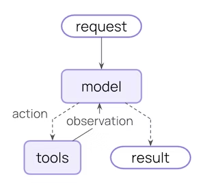
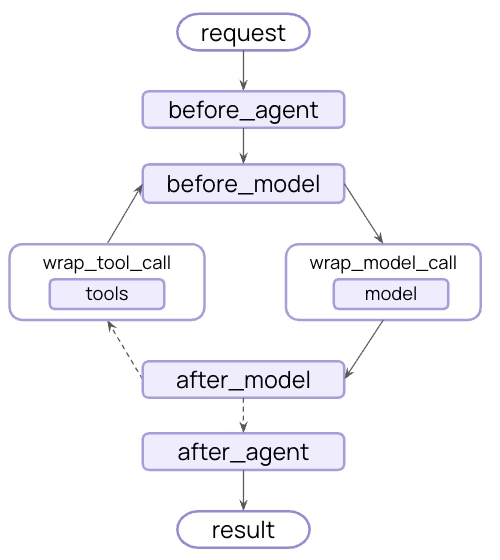

# 遵循ReAct模式开发的基础智能体对象

> 代码主要位于 [./packages/agent/src/index.ts](../packages/agent/src/index.ts)，配套文件还有 [callFuns.ts](../packages/agent/src/callFuns.ts)、[callMiddleware.ts](../packages/agent/src/callMiddleware.ts)

ReAct（Reason + Action）是一种让大语言模型（LLM）具备"思考+行动"能力的智能体模式，它将推理链与外部工具调用结合，使模型不仅能生成答案，还能主动获取实时信息、执行任务并迭代优化结果。

## 核心流程

- 精心设计Prompt：明确任务目标、可用工具及调用规则。

- 推理（Reason）：LLM分析当前信息，判断缺失内容及下一步策略。

- 行动（Action）：调用指定外部工具（如API、计算器、搜索引擎）。

- 观察（Observation）：接收工具返回结果并更新上下文。

- 循环迭代：重复推理-行动-观察，直到信息充分。

- 最终答案（Final Answer）：输出完整结论，结束流程。

下面是简单的流程图：



## 入口：Agent 类的设计

`packages/agent/src/index.ts` 中导出了一个 `Agent` 类，构造函数接收一组配置：

```typescript
new Agent({
    model,        // 一个拥有 completions(...) 方法的 LLM 客户端（见 model.md）
    tools,        // 可选，工具列表（OpenAI tools schema + 可执行函数）
    systemPrompt, // 可选，系统提示词
    middleware    // 可选，生命周期钩子（详见下文"中间件"）
})
```

其中 `tools`、`systemPrompt`、`middleware` 都有默认值（在内部使用 `initOption` 合并），允许调用方只配置 `model` 也能跑起来。

## invoke 方法：ReAct 的真正落地

`invoke(option)` 是对外暴露的唯一执行入口，内部实现了一个匿名递归 IIFE `doit()`，整体流程如下：

1. **构造初始上下文**：把 `systemPrompt` 作为 `system` 角色放在最前面，再把调用方传入的 `messages` 拼在后面。这一段上下文是后续每一轮模型调用都会带上的"记忆"。

2. **触发 `before_agent` 中间件**：在进入推理循环前，给中间件一次拦截的机会。

3. **循环开始（doit）**：
   - 触发 `before_model` 中间件。
   - 调用 `model.completions({ stream: true, messages: context, tools })`，第三个参数 `thinkback` 用于实时把模型的"思考过程"以蓝色文字输出到终端。
   - 拿到 `result`（形如 `{ content, tool_calls }`）：
     - 触发 `after_model` 中间件。
     - 如果有 `content`，把它以 `assistant` 角色压入 `context`。
     - 如果有 `tool_calls`：
       1. 以 `assistant` 角色、附加 `tool_calls` 字段压入 `context`（保留工具调用的原始记录）。
       2. 调用 `callFuns(_this, result.tool_calls)` 执行工具；针对每个工具调用，把返回结果以 `tool` 角色 + `tool_call_id` + `tool_name` + `content` 压回 `context`。
       3. 用 `setTimeout(doit)` 异步再回到第 3 步开头——这正是源码中的一段特殊注释：
          ```
          // 修复llama.cpp奇怪报错
          // Error: socket hang up ...
          //   code: 'ECONNRESET'
          ```
          即直接把递归尾调用包进 `setTimeout`，避免在某些本地推理服务（特别是 llama.cpp）下偶发的 `ECONNRESET` / socket hang up。
     - 如果没有 `tool_calls`：说明模型给出了最终答案，此时 `resolve(result.content)` 结束整个 Promise，并触发 `after_agent` 中间件。

4. **异常路径**：任意一次 `model.completions` 的 reject 会沿着 Promise 链透传到外层 `invoke` 的 `reject`，不会进入死循环。

整段代码的关键设计是：**上下文 `context` 数组在闭包中被持续追加**，ReAct 的"观察"步骤正是通过把每轮工具结果塞回 `context` 来实现的；下一轮 `doit` 时模型会重新拿到完整消息历史，进入下一轮 Reason。

## 工具执行：callFuns

工具调用由 [callFuns.ts](../packages/agent/src/callFuns.ts) 负责，逻辑要点：

- 遍历模型返回的 `tool_calls`，用函数名到 `_this.config.tools[j].description.function.name` 的匹配找到用户注册的 `tool`，再用 `JSON.parse(tool_calls[i].function.arguments)` 解析参数后调用 `tool.valueOf(...)`。
- 单个工具的返回值如果是 `Promise`，会被外面再包一层 `Promise`：成功时把 `data` 收集起来，失败时返回字符串 `"运行出错:" + e`，避免单个工具抛错炸掉整轮调用。
- 找不到对应工具时，会以字符串 `"工具<name>不存在"` 占位，使后续 SSE 的 `tool` 消息依然能进入 `context`，不会让上下文结构错位。
- 所有结果用 `Promise.all(all)` 等待，逐项按 `tool_call_id` 对齐写入 `context`。

> 注意：`tool` 消息的字段名是 `tool_name`（而非 OpenAI 规范中的 `name`），这是本项目自定义的字段，由 `Model.completions` 的接入端（OpenAI 兼容协议）按对应字段读取。

## 中间件

在智能体的特殊阶段，插入生命周期钩子，例如可以实现对上下文管理，设计出记忆系统等。

由 [callMiddleware.ts](../packages/agent/src/callMiddleware.ts) 实现：它很简单——遍历 `_this.config.middleware`，如果某个中间件上有名为当前钩子的方法，就调用它。支持的钩子及其触发时机如下：



| 钩子 | 触发时机 |
| --- | --- |
| `before_agent` | `invoke` 入口处，进入 ReAct 循环之前（仅一次） |
| `before_model` | 每一轮 `model.completions` 调用之前 |
| `after_model` | 每一轮模型返回之后、`context` 写入之前 |
| `after_agent` | 模型给出最终答案、Promise resolve 之后（仅一次） |

钩子接受的参数是 `hook_args`（默认 `undefined`），目前调用时都传的是 `void 0`，因此中间件只能借助闭包（最直接的方式是直接拿到 `_this`/`context`）完成上下文修改、日志记录、计数等副作用。

一个使用示例（见 [test/agent.ts](../test/agent.ts)）：

```typescript
const agent = new Agent({
    model: new Model(),
    tools: [readPlain],
    systemPrompt: "",
    middleware: [{
        before_agent() { console.log("before_agent") },
        before_model() { console.log("before_model") },
        after_model()  { console.log("after_model") },
        after_agent()  { console.log("after_agent") }
    }]
})
```
